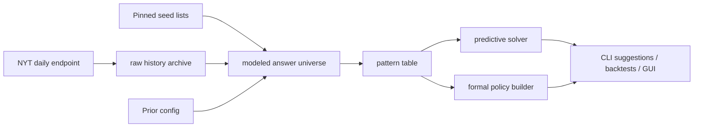

<div align="center">
  <h1>Maybe Wordle</h1>
  <p><strong>A Wordle solver for the NYT era where the answer list stopped behaving like a fixed museum exhibit.</strong></p>
  <p>
    
    
    
    
  </p>
</div>

Classic Wordle solvers assume a fixed answer list and a uniform prior. Since
February 2026 NYT has reused past answers and keeps adding new ones, so Maybe
Wordle models the answer set instead. It fetches the dated answer history,
weights each candidate by whether and how recently it was used, and searches
for the guess that minimises expected guesses under that belief. It ships a
desktop GUI and a CLI, plus a separate certificate-checked solver for fixed
models.

## Results at a glance

| Evaluation of the selected configuration | Games | Solved | Mean guesses | 95% interval |
| --- | ---: | ---: | ---: | ---: |
| Development folds, current build | 360 | 360 | **3.1944** | [3.1194, 3.2722] |
| Promotion guard, July build | 360 | 360 | 3.1778 | [3.1056, 3.2556] |
| Once-only sealed test | 30 | 30 | **3.3000** | [3.1333, 3.4667] |

- The development folds are the ones the configuration was tuned on. The
  sealed test is the only out-of-sample number so far.
- For scale, the published exact optimum for the static game is 3.421 guesses
  with opener `salet`
  ([Bertsimas and Paskov, 2025](https://doi.org/10.1287/opre.2022.0434)).
  The means above are lower because this solver conditions on dated answer
  history, a different information set; they are not a better search of the
  same game.
- An average of three or fewer was a research goal and was not reached. That
  research is closed. An oracle test on 2026-10-12 showed that even knowing
  which pool each answer comes from gives 3.1583. The
  [research close-out](docs/superpowers/plans/2026-10-03-subthree-research.md)
  records what was tried, why it stopped and what would justify reopening it.
- A prospective test is pending. The unchanged selected configuration was
  frozen on 2026-10-12 for the 30 puzzles from 2026-10-13 through 2026-11-11
  ([freeze record](benchmarks/predictive/prospective-frozen-v1.json)). It can
  be scored once, on or after 2026-11-12, and that score will be reported here
  whatever it is.

Open items are listed at the end of the
[research close-out](docs/superpowers/plans/2026-10-03-subthree-research.md#october-12-close-out-pass)
and in [TODO.md](TODO.md).

## Quick start

You need Rust 1.97; `rust-toolchain.toml` selects it.

```bash
cargo run -- sync-data     # fetch the dated NYT answers (network; slowest step on a fresh clone)
cargo run -- build-model   # derive the model files under data/derived/
cargo run                  # open the GUI
```

From the command line:

```bash
cargo run -- suggest --guess crane --feedback 00000 --top 5 --date 2026-03-09
cargo run -- solve-interactive
```

Feedback is five symbols, one per letter: `0` absent, `1` present, `2` correct
(`b`/`y`/`g` also work).

On Windows, `cargo build --release --bins` produces `maybe-wordle-gui.exe`
(double-clickable, no console window) and `maybe-wordle.exe` (the CLI). The
locally packaged copies in the ignored `dist/` directory are named
`maybe-wordle.exe` (GUI) and `maybe-wordle-cli.exe` (CLI). Both locate the
repository's `config/` and `data/` directories from the current directory or
the executable path.

What to expect on a first run:

- `sync-data` backfills one JSON row per puzzle date into
  `data/raw/nyt_daily_answers.jsonl`. It retries missing dates, rechecks the
  most recent days, honours `Retry-After`, and never replaces a contiguous
  archive with a gapped one.
- Missing or incomplete history still allows seed-based predictive play; the
  GUI shows a persistent notice with covered and expected days. Backtests,
  model builds and book builds reject gapped history unless
  `allow_history_gaps = true` is set in `config/prior.toml`.
- Predictive opener and reply books are optional caches
  (`build-predictive-opener`, `build-predictive-replies`). Without them the
  solver ranks live. A corrupt or incompatible current-version book is an
  error, not a silent fallback.
- `formal-optimal` needs `build-optimal-policy` first; it is the heaviest
  build in the repository and is not needed for everyday play.

`sync-data` is intended for personal research. Keep request volume modest and
do not redistribute synced NYT data unless you have the right to do so.

## How it works

| Mode | What it optimises | Use it for |
| --- | --- | --- |
| `predictive` | Heuristic weighted search with bounded candidate pools and exact search in small states | Everyday solving. Its weights are heuristics, not calibrated editorial probabilities. |
| `formal-optimal` | Worst-case depth first, then expected guesses, over one pinned model | Reproducible fixed-model policy analysis |



The model is explicit about what it assumes:

- Guesses: every allowed guess from a pinned snapshot of `tabatkins/wordle-list`.
- Seed answers: a curated candidate list checked into the repository
  (`joshstephenson/Wordle-Solver`, with `LaurentLessard/wordlesolver` as a
  reference list). Source metadata is in
  [`data/seed/sources.toml`](./data/seed/sources.toml).
- History: NYT answers fetched by date from
  `https://www.nytimes.com/svc/wordle/v2/YYYY-MM-DD.json`. A game on a given
  date only sees history through the previous day.
- Modeled answers: seed answers, date-bounded history and manual additions.
- Dormant fallback: every other valid guess, activated only by the declared
  recovery rule, so an unlisted answer can still be solved.

The prior in [`config/prior.toml`](./config/prior.toml) gives seed answers full
base weight, history-only words reduced weight, and applies a cooldown and
recovery curve to used answers. The formulas, the exact-versus-heuristic
boundaries and the verification map are in
[docs/PREDICTIVE_MATH.md](docs/PREDICTIVE_MATH.md).

## The GUI

The GUI is a predictive-first workspace with Play, Policy, Diagnostics and
Formal views. In Play you type a guess, enter feedback as five symbols or by
clicking the tiles, and press Enter. The board, ranked suggestions, a
suggestion inspector and a filterable, exportable candidate list update in the
background; a newer request cancels an obsolete one, and a rejected row keeps
your draft. Tiles carry `A`, `P` and `C` text markers as well as colour. A Text
slider scales the interface from 85% to 135%, and narrow windows stack the
layout into one column. The minimum window is 560 by 620.

On 2026-10-12 the packaged Windows build was checked through UI Automation:
every input control exposes a name, and no control leaves the window at the
minimum size or at 135% text. Keyboard use passed on the preceding build; the
keyboard pass on the final build and a screen-reader pass are still open.

Detailed behaviour and the verification history are in
[docs/EXPERIMENTS.md](docs/EXPERIMENTS.md#gui-behaviour-and-verification-history).

## Evidence

The selected predictive configuration is [`config/prior.toml`](./config/prior.toml), frozen as `selected-predictive-v20`.
The table below is its historical promotion result from an earlier executable;
the September 29 development comparison follows in the generated rolling section.

| Evaluation | Games | Solved | All-game mean | 95% interval | Failures | Latency p95 |
| --- | ---: | ---: | ---: | ---: | ---: | ---: |
| 12-fold rolling development guard | 360 | 360 | **3.1778** | [3.1056, 3.2556] | 0 | 41.60 ms |
| Once-only sealed test | 30 | 30 | **3.3000** | [3.1333, 3.4667] | 0 | 38.50 ms |

Against the previous default, the selected configuration improved the development all-game mean by `-0.1222` guesses with paired block-bootstrap interval `[-0.1722, -0.0722]` and win/tie/loss counts `69/265/26`. It also repaired the previous default's two development failures. The sealed result had full coverage, a median of 3 guesses, p95 of 5, and a maximum of 5.

This historical evidence does **not** support a flat-three claim: the untouched sealed score was `3.3000`. That sealed window is now consumed and cannot be used for further tuning. Machine-readable records are [`rolling-selected-v20-final-20260726.json`](./benchmarks/predictive/rolling-selected-v20-final-20260726.json), [`frozen-candidate-v1.json`](./benchmarks/predictive/frozen-candidate-v1.json), and [`sealed-selected-v20-20260726.json`](./benchmarks/predictive/sealed-selected-v20-20260726.json).

The declared evaluation policy in [`config/evaluation.toml`](./config/evaluation.toml)
freezes development through 2026-08-26 and reserves 2026-08-28 through
2026-09-26 as an unevaluated seal. Ordinary commands cannot score dates outside
development.

The following seven-profile **timing screen** covers only nine allowed dates,
July 28-August 5, 2026 (63 profile-games). Its selected-policy mean of 3.0000
is a small development slice, not a flat-three result or full release
validation. An attempted full seven-profile matrix on the audit build hit its
20-minute cap and was not published. The
[previous-build seven-profile table](./docs/generated/september-seven-profile-current-full-v1.md)
covers all 12 folds for seven baselines; on 2026-10-12 a replay with the
current source reproduced its selected-profile outcome on all 360 games.

<!-- BEGIN GENERATED PREDICTIVE EVIDENCE -->
## Predictive solver evidence

Development-only diagnostic for `2026-07-28` through `2026-08-05` using selection `range` (2026-07-28..2026-08-05) and history through `2026-08-26`. The sealed test was **not** evaluated.

Measured generation compute time: 19.58 s; process peak working set: 122.1 MiB; enforced budget: 180 s / 4096 MiB.

| Baseline | Coverage | Solved | All-game mean (7-guess penalty) | Conditional mean | 3 guesses | 4 guesses | Paired delta vs reference | W/T/L | Log loss | Brier | Latency p95 | Session fallback cold/warm |
| --- | ---: | ---: | ---: | ---: | ---: | ---: | ---: | ---: | ---: | ---: | ---: | ---: |
| `previous_release_790ec2d` | 100.0% (9/9) | 100.0% (9/9) | 3.2222 [3.1111, 3.3333] | 3.2222 [3.1111, 3.3333] (modeled_games=9) | 77.8% | 100.0% | +0.2222 [+0.1111, +0.3333] | 0/7/2 | 7.1629 | 0.9992 | 23.15 ms | n/a/n/a |
| `uniform_entropy` | 100.0% (9/9) | 100.0% (9/9) | 3.4444 [3.2222, 3.6667] | 3.4444 [3.2222, 3.6667] (modeled_games=9) | 55.6% | 100.0% | +0.4444 [+0.2222, +0.6667] | 0/5/4 | 7.7664 | 0.9996 | 24.62 ms | n/a/n/a |
| `cooldown_entropy` | 100.0% (9/9) | 100.0% (9/9) | 3.2222 [3.1111, 3.3333] | 3.2222 [3.1111, 3.3333] (modeled_games=9) | 77.8% | 100.0% | +0.2222 [+0.1111, +0.3333] | 0/7/2 | 7.5965 | 0.9995 | 25.02 ms | n/a/n/a |
| `weighted_proxy_only` | 100.0% (9/9) | 100.0% (9/9) | 3.1111 [3.0000, 3.2222] | 3.1111 [3.0000, 3.2222] (modeled_games=9) | 88.9% | 100.0% | +0.1111 [+0.0000, +0.2222] | 0/8/1 | 6.5562 | 0.9985 | 26.73 ms | n/a/n/a |
| `weighted_proxy_exact_endgame` | 100.0% (9/9) | 100.0% (9/9) | 3.0000 [3.0000, 3.0000] | 3.0000 [3.0000, 3.0000] (modeled_games=9) | 100.0% | 100.0% | +0.0000 [+0.0000, +0.0000] | 0/9/0 | 6.5562 | 0.9985 | 26.78 ms | n/a/n/a |
| `weighted_staged_no_artifacts` | 100.0% (9/9) | 100.0% (9/9) | 3.0000 [3.0000, 3.0000] | 3.0000 [3.0000, 3.0000] (modeled_games=9) | 100.0% | 100.0% | +0.0000 [+0.0000, +0.0000] | 0/9/0 | 6.5562 | 0.9985 | 27.69 ms | n/a/n/a |
| `selected_default_disk_artifacts` | 100.0% (9/9) | 100.0% (9/9) | 3.0000 [3.0000, 3.0000] | 3.0000 [3.0000, 3.0000] (modeled_games=9) | 100.0% | 100.0% | +0.0000 [+0.0000, +0.0000] | 0/9/0 | 6.5562 | 0.9985 | 19.65 ms | n/a/n/a |

Session-fallback timings are milliseconds; n/a means live session books are not used by that profile and were not benchmarked.

Measured artifact sizes: `pattern_table` = 35132187 bytes; `answer_history` = 64472 bytes; `modeled_answers` = 177428 bytes; `predictive_books` = 812321 bytes.

| Baseline | Prior top-1 | Prior top-3 | Prior top-5 | Confidence ECE | Search steps P/L/XE/X/F/T | Recovery/fallback steps | Artifact/session hits |
| --- | ---: | ---: | ---: | ---: | ---: | ---: | ---: |
| `previous_release_790ec2d` | 0.0% | 0.0% | 0.0% | 0.0008 [0.0008, 0.0008] | 9/3/0/17/0/0 | 0/7 | 0/0 |
| `uniform_entropy` | 0.0% | 0.0% | 0.0% | 0.0004 [0.0004, 0.0004] | 31/0/0/0/0/0 | 0/10 | 0/0 |
| `cooldown_entropy` | 0.0% | 0.0% | 0.0% | 0.0005 [0.0005, 0.0005] | 29/0/0/0/0/0 | 0/9 | 0/0 |
| `weighted_proxy_only` | 0.0% | 0.0% | 0.0% | 0.0014 [0.0014, 0.0014] | 28/0/0/0/0/0 | 0/6 | 0/0 |
| `weighted_proxy_exact_endgame` | 0.0% | 0.0% | 0.0% | 0.0014 [0.0014, 0.0014] | 12/0/0/15/0/0 | 0/7 | 0/0 |
| `weighted_staged_no_artifacts` | 0.0% | 0.0% | 0.0% | 0.0014 [0.0014, 0.0014] | 9/3/0/15/0/0 | 0/7 | 0/0 |
| `selected_default_disk_artifacts` | 0.0% | 0.0% | 0.0% | 0.0014 [0.0014, 0.0014] | 9/3/0/15/0/0 | 0/7 | 0/0 |

Post-feedback posterior proper scores (means are conditional on scored states; scored/total keeps unscored gaps visible):

| Baseline | Stratum | Turn | Scored/total states | Target probability | Log loss | Brier |
| --- | --- | ---: | ---: | ---: | ---: | ---: |
| `previous_release_790ec2d` | all | 1 | 9/9 | 0.0008 | 7.1629 | 0.9992 |
| `previous_release_790ec2d` | all | 2 | 9/9 | 0.0715 | 3.0110 | 0.9259 |
| `previous_release_790ec2d` | all | 3 | 9/9 | 0.8482 | 0.2243 | 0.1294 |
| `previous_release_790ec2d` | all | 4 | 2/2 | 0.7500 | 0.3466 | 0.2500 |
| `previous_release_790ec2d` | never_used | 1 | 8/8 | 0.0008 | 7.1629 | 0.9992 |
| `previous_release_790ec2d` | never_used | 2 | 8/8 | 0.0495 | 3.2128 | 0.9482 |
| `previous_release_790ec2d` | never_used | 3 | 8/8 | 0.8392 | 0.2420 | 0.1448 |
| `previous_release_790ec2d` | never_used | 4 | 2/2 | 0.7500 | 0.3466 | 0.2500 |
| `previous_release_790ec2d` | reused | 1 | 1/1 | 0.0008 | 7.1630 | 0.9992 |
| `previous_release_790ec2d` | reused | 2 | 1/1 | 0.2474 | 1.3967 | 0.7480 |
| `previous_release_790ec2d` | reused | 3 | 1/1 | 0.9207 | 0.0827 | 0.0069 |
| `uniform_entropy` | all | 1 | 9/9 | 0.0004 | 7.7664 | 0.9996 |
| `uniform_entropy` | all | 2 | 9/9 | 0.0458 | 3.5389 | 0.9542 |
| `uniform_entropy` | all | 3 | 9/9 | 0.6350 | 0.5995 | 0.3491 |
| `uniform_entropy` | all | 4 | 4/4 | 0.9967 | 0.0033 | 0.0001 |
| `uniform_entropy` | never_used | 1 | 8/8 | 0.0004 | 7.7664 | 0.9996 |
| `uniform_entropy` | never_used | 2 | 8/8 | 0.0501 | 3.4216 | 0.9499 |
| `uniform_entropy` | never_used | 3 | 8/8 | 0.6894 | 0.4732 | 0.2927 |
| `uniform_entropy` | never_used | 4 | 3/3 | 0.9956 | 0.0045 | 0.0001 |
| `uniform_entropy` | reused | 1 | 1/1 | 0.0004 | 7.7664 | 0.9996 |
| `uniform_entropy` | reused | 2 | 1/1 | 0.0114 | 4.4773 | 0.9886 |
| `uniform_entropy` | reused | 3 | 1/1 | 0.2000 | 1.6094 | 0.8000 |
| `uniform_entropy` | reused | 4 | 1/1 | 1.0000 | -0.0000 | 0.0000 |
| `cooldown_entropy` | all | 1 | 9/9 | 0.0005 | 7.5965 | 0.9995 |
| `cooldown_entropy` | all | 2 | 9/9 | 0.0489 | 3.4098 | 0.9510 |
| `cooldown_entropy` | all | 3 | 9/9 | 0.7600 | 0.3307 | 0.2230 |
| `cooldown_entropy` | all | 4 | 2/2 | 1.0000 | -0.0000 | 0.0000 |
| `cooldown_entropy` | never_used | 1 | 8/8 | 0.0005 | 7.5965 | 0.9995 |
| `cooldown_entropy` | never_used | 2 | 8/8 | 0.0533 | 3.3017 | 0.9467 |
| `cooldown_entropy` | never_used | 3 | 8/8 | 0.7934 | 0.2835 | 0.1884 |
| `cooldown_entropy` | never_used | 4 | 2/2 | 1.0000 | -0.0000 | 0.0000 |
| `cooldown_entropy` | reused | 1 | 1/1 | 0.0005 | 7.5965 | 0.9995 |
| `cooldown_entropy` | reused | 2 | 1/1 | 0.0139 | 4.2743 | 0.9860 |
| `cooldown_entropy` | reused | 3 | 1/1 | 0.4926 | 0.7080 | 0.5002 |
| `weighted_proxy_only` | all | 1 | 9/9 | 0.0014 | 6.5562 | 0.9985 |
| `weighted_proxy_only` | all | 2 | 9/9 | 0.1360 | 2.3725 | 0.8547 |
| `weighted_proxy_only` | all | 3 | 9/9 | 0.8546 | 0.2155 | 0.1302 |
| `weighted_proxy_only` | all | 4 | 1/1 | 0.5009 | 0.6913 | 0.4982 |
| `weighted_proxy_only` | never_used | 1 | 8/8 | 0.0014 | 6.5532 | 0.9985 |
| `weighted_proxy_only` | never_used | 2 | 8/8 | 0.1129 | 2.5270 | 0.8767 |
| `weighted_proxy_only` | never_used | 3 | 8/8 | 0.8432 | 0.2354 | 0.1461 |
| `weighted_proxy_only` | never_used | 4 | 1/1 | 0.5009 | 0.6913 | 0.4982 |
| `weighted_proxy_only` | reused | 1 | 1/1 | 0.0014 | 6.5799 | 0.9986 |
| `weighted_proxy_only` | reused | 2 | 1/1 | 0.3210 | 1.1364 | 0.6784 |
| `weighted_proxy_only` | reused | 3 | 1/1 | 0.9456 | 0.0559 | 0.0033 |
| `weighted_proxy_exact_endgame` | all | 1 | 9/9 | 0.0014 | 6.5562 | 0.9985 |
| `weighted_proxy_exact_endgame` | all | 2 | 9/9 | 0.1360 | 2.3725 | 0.8547 |
| `weighted_proxy_exact_endgame` | all | 3 | 9/9 | 0.9212 | 0.1011 | 0.0566 |
| `weighted_proxy_exact_endgame` | never_used | 1 | 8/8 | 0.0014 | 6.5532 | 0.9985 |
| `weighted_proxy_exact_endgame` | never_used | 2 | 8/8 | 0.1129 | 2.5270 | 0.8767 |
| `weighted_proxy_exact_endgame` | never_used | 3 | 8/8 | 0.9182 | 0.1068 | 0.0633 |
| `weighted_proxy_exact_endgame` | reused | 1 | 1/1 | 0.0014 | 6.5799 | 0.9986 |
| `weighted_proxy_exact_endgame` | reused | 2 | 1/1 | 0.3210 | 1.1364 | 0.6784 |
| `weighted_proxy_exact_endgame` | reused | 3 | 1/1 | 0.9456 | 0.0559 | 0.0033 |
| `weighted_staged_no_artifacts` | all | 1 | 9/9 | 0.0014 | 6.5562 | 0.9985 |
| `weighted_staged_no_artifacts` | all | 2 | 9/9 | 0.1360 | 2.3725 | 0.8547 |
| `weighted_staged_no_artifacts` | all | 3 | 9/9 | 0.9740 | 0.0265 | 0.0012 |
| `weighted_staged_no_artifacts` | never_used | 1 | 8/8 | 0.0014 | 6.5532 | 0.9985 |
| `weighted_staged_no_artifacts` | never_used | 2 | 8/8 | 0.1129 | 2.5270 | 0.8767 |
| `weighted_staged_no_artifacts` | never_used | 3 | 8/8 | 0.9775 | 0.0228 | 0.0009 |
| `weighted_staged_no_artifacts` | reused | 1 | 1/1 | 0.0014 | 6.5799 | 0.9986 |
| `weighted_staged_no_artifacts` | reused | 2 | 1/1 | 0.3210 | 1.1364 | 0.6784 |
| `weighted_staged_no_artifacts` | reused | 3 | 1/1 | 0.9456 | 0.0559 | 0.0033 |
| `selected_default_disk_artifacts` | all | 1 | 9/9 | 0.0014 | 6.5562 | 0.9985 |
| `selected_default_disk_artifacts` | all | 2 | 9/9 | 0.1360 | 2.3725 | 0.8547 |
| `selected_default_disk_artifacts` | all | 3 | 9/9 | 0.9740 | 0.0265 | 0.0012 |
| `selected_default_disk_artifacts` | never_used | 1 | 8/8 | 0.0014 | 6.5532 | 0.9985 |
| `selected_default_disk_artifacts` | never_used | 2 | 8/8 | 0.1129 | 2.5270 | 0.8767 |
| `selected_default_disk_artifacts` | never_used | 3 | 8/8 | 0.9775 | 0.0228 | 0.0009 |
| `selected_default_disk_artifacts` | reused | 1 | 1/1 | 0.0014 | 6.5799 | 0.9986 |
| `selected_default_disk_artifacts` | reused | 2 | 1/1 | 0.3210 | 1.1364 | 0.6784 |
| `selected_default_disk_artifacts` | reused | 3 | 1/1 | 0.9456 | 0.0559 | 0.0033 |

Reference `selected_default_disk_artifacts` all-game mean sensitivity: penalty 6 = 3.0000 [3.0000, 3.0000]; penalty 7 = 3.0000 [3.0000, 3.0000]; penalty 8 = 3.0000 [3.0000, 3.0000].

The old `3.2222` figure was conditional on 27 modeled games and omitted three coverage gaps. It is retained only as an attribution baseline, not as current performance. A flat three guesses is an aspiration; it is not supported unless the failure-penalized all-game sealed-test result reaches it after configuration freeze.

The source JSON artifact records the `release_command`, full provenance, per-game paths, effective profile configs, paired comparisons, and limitations. Regenerate documentation with `benchmark-evidence-docs --evidence <source-json> --markdown-output <fragment> --readme <readme> --update`.
<!-- END GENERATED PREDICTIVE EVIDENCE -->

For clean-checkout documentation checks, the [audit timing-screen evidence](./docs/evidence/september-audit-timing-screen-public-v1.json),
[audit rolling comparison](./docs/evidence/september-audit-rolling-public-v1.json),
[seven-profile evidence](./docs/evidence/september-seven-profile-current-full-public-v1.json),
[earlier selected-versus-v19b evidence](./docs/evidence/september-post-layout-tests-rolling-public-v1.json),
and [earlier rolling comparison](./docs/evidence/september-finite-preordered-public-v1.json)
retain per-date outcomes, path lengths, calibration numbers, and provenance but
redact target and guess words. CI checks outcome-derived score and coverage
arithmetic and re-renders the tables from these copies; it does not authenticate
the private raw history or independently recompute every calibration, latency,
and resource field. The word-bearing source artifacts remain local. Run
`pwsh -NoProfile -File scripts/redact_public_evidence.ps1 -Check` to validate the public copies in a
clean checkout; regenerating them requires the private source artifacts.

The generated rolling table below compares selected v20 staged with exploratory
v19b on all 12 allowed development folds.

<!-- BEGIN GENERATED ROLLING EVIDENCE -->
### Rolling-origin promotion guard

Across 12 non-overlapping development folds (360 scheduled games), the sealed test was **not** evaluated. Coverage gaps and six-guess failures are hard constraints before mean score.

| Configuration | Solved | All-game mean | Delta vs baseline | W/T/L | Latency p95 | Guard decision |
| --- | ---: | ---: | ---: | ---: | ---: | --- |
| `audit_selected_staged` | 360/360 | 3.1944 [3.1194, 3.2722] | reference | -- | 28.29 ms | retained |
| `audit_v19b_staged` | 360/360 | 3.1917 [3.1194, 3.2694] | -0.0028 [-0.0222, +0.0167] | 6/347/7 | 27.25 ms | not promoted: improvement uncertain |

| Configuration | Prior top-1/3/5 | Confidence ECE | Search steps P/L/XE/X/F/T | Recovery/fallback steps |
| --- | ---: | ---: | ---: | ---: |
| `audit_selected_staged` | 0.3%/0.6%/0.6% | 0.0017 [0.0013, 0.0077] | 386/139/0/609/0/16 | 36/292 |
| `audit_v19b_staged` | 0.3%/0.6%/0.6% | 0.0017 [0.0013, 0.0077] | 386/131/0/618/0/14 | 36/297 |

Development decisions:

- `audit_v19b_staged` is retained as a development finalist, not promoted, because the observed improvement's paired interval includes zero.

This development comparison did not access the sealed window and does not establish prospective performance. Any later sealed evaluation requires separate evidence.
<!-- END GENERATED ROLLING EVIDENCE -->

The September experiments behind these tables, including the rejected
finite-horizon, learned-proxy and survival-prior routes, are summarised in
[docs/EXPERIMENTS.md](docs/EXPERIMENTS.md).

## Formal mode

`formal-optimal` is a fixed-model analysis mode, not a prediction of NYT editorial choices. It loads `data/formal/<model>/current.json`, whose checksums select one immutable `generations/gen-.../` directory.

```bash
cargo run --release -- build-optimal-policy --model formal-v1
cargo run --release -- verify-optimal-policy --model formal-v1
```

The objective first finds the minimum feasible worst-case depth, then minimises expected cost conditional on that remaining depth. The certificate records a witness for every candidate, and an independent verifier reconstructs feedback partitions, child states, probability masses, objective comparisons and proof closure without calling the optimizer or sharing the builder's partition code. A third slow reference and mutation tests cross-check tractable randomized universes.

Formal claims are limited to independently verified tractable universes. The machine-readable [`scale-v2.json`](./benchmarks/formal/scale-v2.json) benchmark used the full 14,855-word guess list with pinned answer prefixes through eight answers: the eight-answer certificate was about 1.05 GiB with a 2.48 GiB process peak, and the next run was stopped because its projected peak exceeded the declared 4 GiB budget. Constructing the complete 2,358-answer model this way is infeasible.

Artifacts are versioned; stale or mixed files are rejected rather than repaired. See [docs/PERSISTENCE.md](docs/PERSISTENCE.md).

## Commands

Run `cargo run -- <command> --help` for options.

| Purpose | Commands |
| --- | --- |
| Play | `gui`, `suggest`, `solve-interactive`, `explain-state` |
| Data and models | `sync-data`, `build-model`, `add-manual`, `reconcile-seeds`, `merge-seeds`, `build-predictive-opener`, `build-predictive-replies` |
| Formal solver | `build-optimal-policy`, `verify-optimal-policy`, `formal-scale` |
| Evaluation and evidence | `backtest`, `experiments`, `evaluation-plan`, `benchmark`, `benchmark-evidence`, `benchmark-evidence-docs`, `rolling-compare`, `rolling-evidence-docs` |
| Research studies | `study-run`, `tune-prior`, `fit-proxy-weights`, `parameter-registry`, `predictive-ablations`, `prior-ablations`, `evaluate-live-config`, `three-guess-gap`, `four-guess-openers`, `search-regret`, `same-state-dynamic-regret`, `staged-zero-failure-certificate` |
| Once-only evaluations | `freeze-candidate`, `evaluate-sealed`, `freeze-prospective`, `evaluate-prospective` |

`backtest` and `experiments` require an explicit range inside declared
development. They reject the consumed June 18-July 17 validation window and
the reserved August 28-September 26 seal.

## Repository layout

```text
config/       prior.toml (selected configuration), evaluation.toml, experiment matrices, candidates
data/seed/    pinned guess and answer lists with provenance
data/raw/     synced NYT history (ignored)
data/derived/ generated model files, pattern table and predictive books (ignored)
data/formal/  formal artifacts by model id (generated files ignored)
src/          main.rs (CLI), gui.rs and gui/ (GUI), solver.rs and solver/ (search, evaluation),
              predictive/ (policies and state), formal.rs and formal/ (builder and verifier),
              scoring.rs, model.rs, pattern_table.rs, atomic_file.rs, experiments/
tests/        integration and predictive characterization tests
benches/      Criterion benchmarks and the performance profile
benchmarks/   retained machine-readable evidence
docs/         see below
```

## Development

```bash
cargo fmt --check
cargo clippy --all-targets -- -D warnings
cargo test --all-targets
```

CI runs the tests on Windows, Linux and macOS without opening a window, runs
formatting and Clippy on Windows, then verifies the generated evidence blocks
in this file. Duplicate-letter scoring,
date-bounded history, recovery behaviour, atomic persistence and the formal
verifier each have dedicated regression coverage. Sync, model generation,
formal builds, studies and benchmarks are not smoke tests: they can fetch
data, replace artifacts or run for a long time.

## Documentation

| Document | What it covers |
| --- | --- |
| [docs/PREDICTIVE_MATH.md](docs/PREDICTIVE_MATH.md) | The mathematical contract of the predictive solver |
| [docs/EXPERIMENTS.md](docs/EXPERIMENTS.md) | Experiment and evidence tooling, September 2026 experiment notes, GUI behaviour and verification history |
| [docs/PERFORMANCE.md](docs/PERFORMANCE.md) | Latency and resource measurements and how to reproduce them |
| [docs/PERSISTENCE.md](docs/PERSISTENCE.md) | Atomic artifact replacement, formal generations and once-only evaluation markers |
| [docs/DEPENDENCIES.md](docs/DEPENDENCIES.md) | Dependency, CI and audit-exception policy |
| [Research close-out](docs/superpowers/plans/2026-10-03-subthree-research.md) | Why the sub-three research stopped, the oracle kill-test and the reopening bar |
| [docs/SEPTEMBER_RELEASE.md](docs/SEPTEMBER_RELEASE.md) | The September 2026 acceptance ledger (historical) |
| [Audit remediation](docs/superpowers/plans/2026-09-29-audit-remediation.md) and [score diagnosis](docs/superpowers/plans/2026-09-29-score-diagnosis.md) | The September 29 audit fixes and where the guesses go |
| [PLAN.md](PLAN.md) | The original design plan (historical) |

## License

[MIT](LICENSE)
